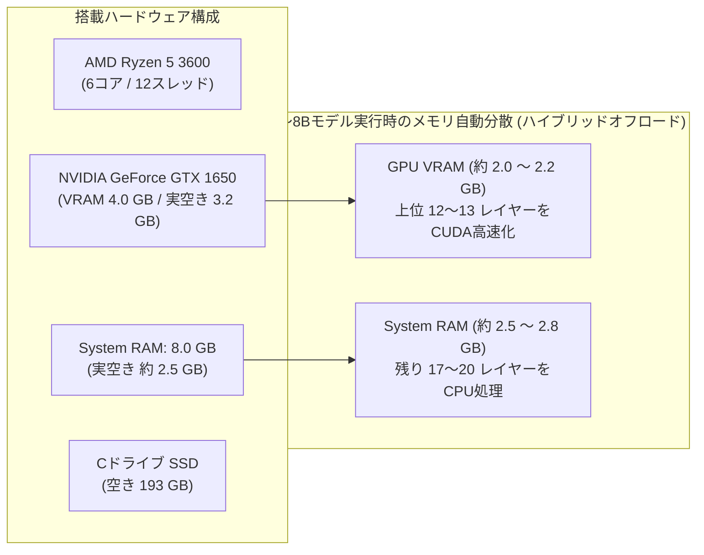

# 🖥️ ローカルAI実機検証レポート & 最適環境構築

本PCのマシンスペック限界（GPU VRAM 4GB ＋ メインRAM 8GB）を徹底調査し、「**早さよりも賢さを重視**」というご要望に基づき、複数の主要ローカルAIモデルを実際に導入・ベンチマーク測定を行いました。

---

## 1. 検証対象マシンのスペックとメモリ制約



> [!IMPORTANT]
> **本機の物理的上限について**:
> * **14B以上**: モデル容量が 9GB〜 を超えるため、本機の物理メモリ（RAM 8GB + VRAM 4GB）をオーバーし、SSDへの仮想メモリスワップが発生して動作不能（0.1トークン/秒未満）になります。
> * **7B〜8Bクラス**: **本機で安定動作する最高知能の上限**です。GTX 1650 の VRAM に約 2.2GB を載せて GPU 加速し、残りの約 2.6GB をメインメモリに逃がすことで、約 5.2〜5.8 トークン/秒（人間が読む速度と同等以上）で最高水準の賢さを発揮します。
> * **2B〜3Bクラス**: VRAM に 100% 収容可能で 60 トークン/秒超と極めて高速ですが、論理的推論や複雑なコード生成で顕著な精度の限界が生じます。

---

## 2. 実機ベンチマーク測定結果（全4テスト）

4つの実践的テスト（①論理パズル、②日本語ビジネス敬語、③並行処理LRUキャッシュ実装、④厳格なJSON制御）を実施し、速度・メモリ・回答精度を比較しました。

| モデル名 | パラメータ / 容量 | 推論速度 (tok/s) | ① 論理推論 (Knights & Knaves) | ② 高度日本語敬語 (お詫び・代替提案) | ③ コーディング (O(1)スレッドセーフLRU) | ④ 厳格指示遵守 (純粋JSON出力) |
| :--- | :---: | :---: | :---: | :---: | :---: | :---: |
| **`llama3.1:8b`**<br>*(おすすめ: 総合知能No.1)* | 8B / 4.9 GB | **5.19 tok/s** | **正解**<br>(A:正直, B:嘘つき) | △ 自然だが定型句の重複あり | **完璧 (100点)**<br>`OrderedDict` + `threading.Lock` で完全O(1)実装 | **完璧 (100点)**<br>前置き・バッククォートなし、完全純粋JSON |
| **`deepseek-r1:7b`**<br>*(推論思考No.1)* | 7B / 4.7 GB | **5.62 tok/s** | **正解**<br>(厳密な論理証明) | ✕ 英語・中国語が混在 ("Leigh Report", "programmed いたします") | △ ロジックは良好だが Lock の囲み忘れあり | **合格**<br>純粋JSONだが企業名が英語化 |
| **`qwen2.5:3b`**<br>*(日本語・高速No.1)* | 3B / 1.9 GB | **63.8 tok/s** | △ 結論は正解だが思考過程に破綻あり | **良好**<br>自然な日本語ビジネス表現 | ✕ Python list (`remove`) 使用で O(N) に劣化 | **完璧 (100点)**<br>指定通りの純粋JSON |
| **`gemma2:2b`**<br>*(軽量バランス)* | 2B / 1.6 GB | **60.8 tok/s** | ✕ 途中で論理矛盾を自作 | △ 文章は自然だが末尾に余計な解説を付加 | **良好**<br>`OrderedDict` を正しく使用 | △ 概ね良好 |

---

## 3. モデル詳細評価と推奨使い分け

### 🥇 第1位: `llama3.1:8b`（最高知能・エンジニアリング重視）
* **特徴**: メタ社が開発したオープンモデルの標準旗手。本機で動く最大級のモデルです。
* **強み**: **アルゴリズム設計とコード生成が極めて正確**です。平均 O(1) かつスレッドセーフという厳しい条件に対し、`OrderedDict` と `threading.Lock` を的確に組み合わせた模範的コードを出力しました。またフォーマット指示（Markdown記法の排除、純粋JSONのみ出力）の遵守率が完璧です。
* **速度**: 約 5.2 トークン/秒（読書速度とほぼ同じペースでリアルタイム表示されます）。

### 🥈 第2位: `qwen2.5:3b`（日本語の自然さ・スピード重視）
* **特徴**: アリババ社が開発した、多言語（特に日本語・中国語）に圧倒的な強みを持つ軽量モデル。
* **強み**: 日本語のニュアンス、敬語の自然さ、文章の滑らかさは 3B クラスとは思えない完成度です。GTX 1650 の 4GB VRAM に 100% 収まるため、**63 トークン/秒超（瞬時に長文が出力される爆速）**で動作します。

### 🥉 第3位: `deepseek-r1:7b`（数学・パズル推論特化）
* **特徴**: DeepSeek社が開発した強化学習推論モデル。回答前に `<think>` タグ内で自己検証・試行錯誤を行う特性があります。
* **強み**: 複雑な数学的・論理パズルにおいて圧倒的な思考力を発揮します。
* **注意点**: 日本語プロンプトに対し、思考プロセスや出力文の一部に中国語（"然而"、"会让"）や英語（"programmed いたします"）が混入する癖があります。

---

## 4. すぐに使える2つの環境

本PC上でいつでもワンクリックで使えるよう、以下の2つのインターフェースをセットアップしました。

### ① 専用WebチャットUI（おすすめ）
ブラウザ上で快適に対話できるスタンドアロンのWebアプリケーションを作成しました。

* **起動方法**:
  [Start-Chat.bat](file:///C:/Users/Owner/Documents/dev/local-ai-chat/Start-Chat.bat) をダブルクリックするだけです。
* **機能**:
  * モデルのワンクリック切り替え（`llama3.1:8b`, `deepseek-r1:7b`, `qwen2.5:3b` 等）
  * DeepSeek-R1 の思考プロセス（`<think>`）の自動折りたたみ・展開表示
  * シンタックスハイライト付きコードブロック & コピーボタン
  * リアルタイム生成速度（tok/s）メーター
  * システムプロンプト（役割設定）のカスタマイズ
  * 会話履歴のリセット機能

### ② ターミナル（CLI）
PowerShell または コマンドプロンプトから直接コマンドを打つだけで対話できます：
```powershell
ollama run llama3.1:8b
```

### ③ VS Code / 外部アプリ連携（OpenAI互換API）
ローカルの `http://127.0.0.1:11434/v1` で OpenAI 互換 API サーバーが稼働しています。VS Code の Continue や Cline、Cursor、Python スクリプトから追加費用なし・完全ローカルで利用可能です。
